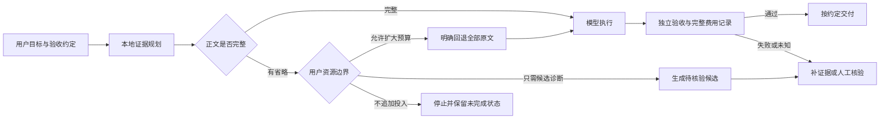

# 从证据保留到任务资源分配

课题仍是《面向用户目标的智能体任务评估与资源分配方法研究及平台开发》。片段选择只是其中一个方法组件，软件成果要把目标、证据、资源边界与交付状态串起来。

目前的真实反例提示：减少正文可能遗漏关键句，候选答对也未必满足交付条件；直接停止可以避免错误交付，但任务没有完成；回退全文可能恢复验收，却增加输入预算。这些是不同任务状态和取舍，不能都归成“少用 tokens”。

## 当前软件已经支撑的流程

目标约定提供必需项和权重，验收证据有通过/失败/未知状态，记录包含探索、执行、验证过程。策略比较仅在同任务、同声明条件中进行；失败、证据不完整、成本未知和超预算记录不能成为推荐。

停止前核验页面可以选择 v1/v2/v3，检查资料与正文预算、原文范围、证据组、完全未提交来源及规则线索。真实实验记录分别展示候选、放行、最终验收、未完成、跳过、未运行和费用。v3 全文回退在记录中公开预算扩大，不冒充半量上下文。

模型执行器与平台评估逻辑分离，接入不同执行器可以做适配器；评价界面、协议存档、策略比较和资源决策属于独立平台。当前只有固定配置任务及一个受限修复题的真实连接，尚未证明跨场景适用。

## 下一阶段应新增的证据

| 问题 | 应记录的观测 | 当前缺口 |
|---|---|---|
| 用户能接受何种未完成状态 | 目标优先级、候选用途、是否允许扩大预算 | 尚未进行目标用户访谈 |
| 补读是否优于全读 | 同题相同验收下的全部调用成本、补读次数和完成率 | v3 目前为调用前全文回退，未验证逐步补读 |
| 人工介入是否值得 | 用户核验时间、返工次数和最终质量 | 未测量真实人工负担 |
| 方法能否适用真实工作 | 外部编题或自然任务、盲评、固定运行条件 | 人工题与开发者编题不能代替 |
| 资源分配是否有收益 | 同等完成约定、完整费用与未完成率的配对比较 | token 不是硬件算力，不能只报较低输入 |

## 可用于大创材料的阶段表述

已经形成可运行的网页原型、真实执行连接、冻结协议、成本存档和失败审计。研究问题从“AI 是否做了多余步骤”收敛到“在证据不完整和资源受限时，如何选择补充、停止或人工核验，并验证是否实现用户目标”。

已有实验识别到词语覆盖、数值一致与来源引文不足以证明配置规则完整。v3 将约束线索成组保留，并用全过程记录比较候选诊断和全文回退；结果与未运行部分见 [真实评估检查点](bundle-study-report.md)。目前不宜写“显著降低算力”或“提高通用准确率”。

后续成果可以包括目标约定工作台、证据检查面板、资源决策记录、真实任务评估集和适配器接口。每次方法迭代都保留旧失败记录，以新的冻结协议评估新增任务。

## v0.15 资源决策工作台

本机 `/decision.html` 提供可交互规划：填写资料与目标，选择最终响应或候选用途，设置正文预算，并明确是否允许扩大预算。三条路径分别显示拟调用次数、拟提交字符、预算扩大与验收状态；建议仅来自当前交付约定和覆盖约束，不预测模型答案质量。

用户选择路径并填写依据后，最多20条记录保存在当前浏览器，可生成JSON。记录含输入资料，执行状态始终 `not_executed`，实际调用为0、预计tokens为null，人工耗时 `not_measured`。修改目标、预算、资料或预算授权会使旧比较失效；预算禁止的全文路径不能保存。这里没有模型执行接口，未来执行与验收另行关联。

v3协议已在额度边界停止：39调用、580180已知tokens、1未知费用、217未运行格，且仅运行第一轮前缀。停止结果单独保留，不把额度刷新当作继续原协议的理由。
